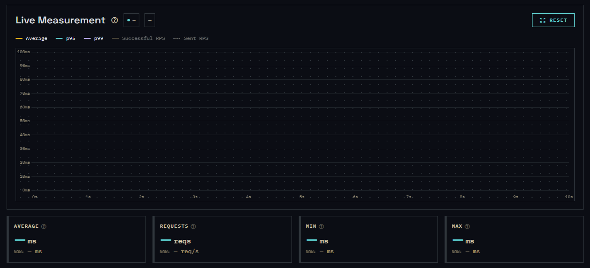
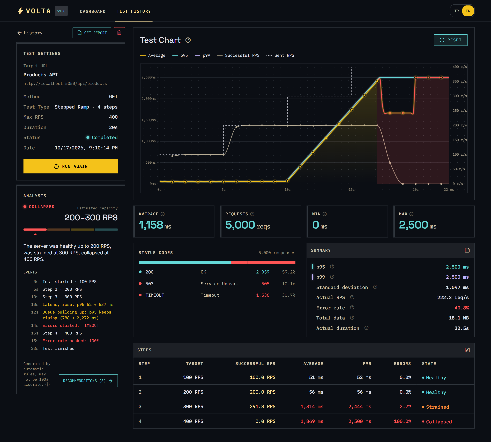
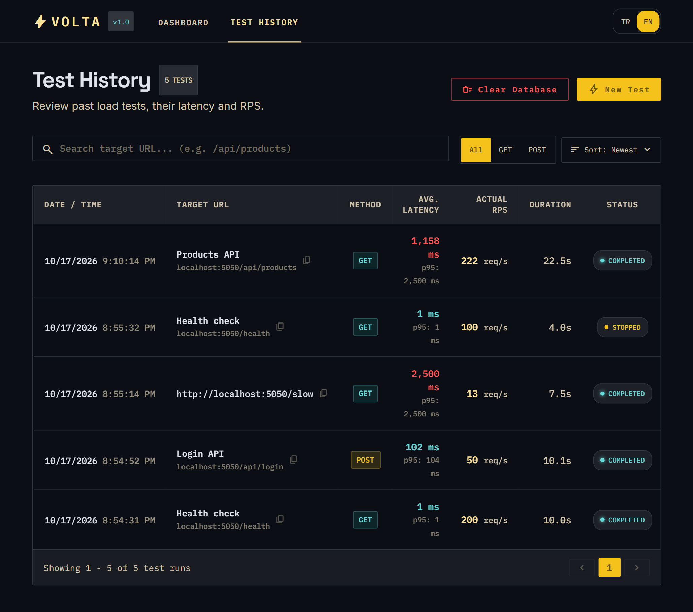

<h1 align="center">
   Volta
</h1>

<p align="center">
  <b>Yerel sunucunun sınırlarını kullanıcıların bulmadan sen bul.</b><br>
  Localhost için görsel yük testi: canlı grafikler ve sonuçları anlaşılır bir dille açıklayan otomatik analiz.
</p>

<p align="center">
  <a href="LICENSE"></a>
  
  
  <a href="https://github.com/ard-daskiran/voltaload/actions/workflows/ci.yml"></a>
</p>

<p align="center">
  <a href="#kurulum">Kurulum</a> ·
  <a href="docs/usage.tr.md">Kullanım</a> ·
  <a href="docs/reading-results.tr.md">Sonuçları okumak</a> ·
  <a href="docs/configuration.tr.md">Ayarlar</a>
</p>

<p align="center"><a href="README.md">English</a> | <b>Türkçe</b></p>



## Volta nedir?

Yük testi, bir sunucunun aynı anda gelen çok sayıda isteğe nasıl dayandığını ölçmektir. Volta bunu senin için yapar: Seçtiğin bir adrese (örneğin `localhost:3000/api/products`) saniyede belirlediğin sayıda istek gönderir, cevapları ölçer ve sonucu canlı bir grafikte gösterir.

## Neden Volta?

Projeni yayına almadan önce, genelde kaç isteği kaldırabildiğini bilmezsin. Volta tarayıcıda çalışır, betik gerektirmez ve sonuçları senin yerine yorumlar:

> _Sunucun 200 RPS'e kadar sorunsuz çalıştı, 300 RPS'te kuyruk birikmeye başladı ve 400 RPS'te çöktü._

Kendi bilgisayarında çalışır ve Node.js dışında hiçbir şeye ihtiyaç duymaz.

## Özellikler

- **Sabit ve kademeli testler:** İstekleri sabit bir hızla gönder ya da sunucunun nerede zorlanmaya başladığını bulmak için yükü kademe kademe artır.
- **Canlı grafik:** Ortalama, p95 ve p99 gecikme, saniyede gönderilen ve başarılı istekler; hatalar oluştukları anda işaretlenir.
- **Otomatik analiz:** Bir sonuç (Sağlıklı, Sınırda, Zorlandı ya da Çöktü), tahmini bir kapasite aralığı, olup bitenlerin zaman çizelgesi ve tek tıkla çalıştırılabilen takip testleriyle öneriler.
- **Geçmiş:** Her test grafiği ve analiziyle birlikte; aranabilir ve filtrelenebilir.
- **Rapor:** PDF olarak kaydedebileceğin, yazdırılabilir bir sayfa.
- **Kayıtlı hedefler:** Sık test ettiğin adresleri sakla.
- **GET ve POST** istekleri, isteğe bağlı JSON gövdesiyle.
- **Özel başlıklar:** Giriş gerektiren adresleri test etmek için token, çerez ya da API anahtarı gönder. Gizlediğin değerler test detayında ve raporda maskeli görünür.
- **İngilizce ve Türkçe** arayüz.

## Gereksinimler

- [Node.js](https://nodejs.org) 22.19 ya da daha yenisi (LTS sürümü önerilir)

Başka bir şey gerekmez. Veritabanı, kurulum sırasında oluşturulan yerel bir dosyadır.

## Kurulum

```bash
git clone https://github.com/ard-daskiran/voltaload.git
cd voltaload
npm install
npm start
```

Sonra tarayıcında **http://localhost:4400** adresini aç.

`npm install`, Volta'nın ihtiyaç duyduğu her şeyi de hazırlar: Node.js sürümünü kontrol eder, veritabanını ve varsayılan ayarlarla bir `.env` dosyası oluşturur. `npm start` Volta'yı derler ve başlatır. Durdurmak için terminalde `Ctrl+C`'ye bas.

**Güncelleme:** `git pull` çalıştır, ardından yine `npm install` ve `npm start`. Test geçmişin korunur.

## İlk testin

1. Test etmek istediğin projeyi başlat, örneğin `http://localhost:3000` adresinde.
2. Volta'yı aç ve test etmek istediğin adresi gir, örneğin `localhost:3000/api/products`.
3. Saniyede **50** istekle **10** saniyelik sabit bir test seç ve başlat.
4. Canlı grafiği izle. Test bitince analizi görmek için **TEST HISTORY** sayfasından aç.

Ardından sunucunun nerede zorlanmaya başladığını görmek için kademeli bir test dene (örneğin 20 saniyede, 4 kademede saniyede 400 isteğe kadar).

**Rehberler:**

- [Kullanım](docs/usage.tr.md): bütün seçenekler, hedef rehberi, geçmiş ve raporlar
- [Sonuçları okumak](docs/reading-results.tr.md): grafik, sonuç, kapasite, olaylar ve öneriler
- [Ayarlar](docs/configuration.tr.md): sınırlar, zaman aşımı, port ve diğer ayarlar

## Ekran görüntüleri

<table>
  <tr>
    <th width="50%">Test detayı ve analiz</th>
    <th width="50%">Test geçmişi</th>
  </tr>
  <tr>
    <td valign="top"></td>
    <td valign="top"></td>
  </tr>
</table>

## Güvenlik

Volta, kendi yazılımını kendi bilgisayarında test etmek için tasarlandı:

- **Sadece yerel ve özel ağ adresleri** test edilebilir: `localhost`, `127.0.0.0/8`, `10.0.0.0/8`, `172.16.0.0/12`, `192.168.0.0/16`, `::1` ve `fc00::/7`. Volta bir adın gerçekte hangi adrese çözüldüğüne bakar ve sadece o adrese bağlanır; böylece test sırasında bir ad başka bir yere yönlendirilemez.
- **Arayüze sadece kendi bilgisayarından erişilebilir** (`127.0.0.1`), tarayıcında açık olan başka sitelerden gelen istekler reddedilir.
- **Yerleşik sınırlar:** Varsayılan olarak saniyede 1000 istek ve 60 saniye, aynı anda tek test. Yönlendirmeler takip edilmez.
- **TLS sertifikaları doğrulanmaz;** böylece kendinden imzalı sertifika kullanan yerel HTTPS sunucuları da test edilebilir.

## Performans

Volta istekleri ayrı bir iş parçacığından, hassas bir hızla gönderir ve test sırasında kendi zamanlamasını ölçer (_Volta gecikmesi_ olarak gösterilir).

Windows üzerinde yaptığımız testlerde Volta **saniyede yaklaşık 3000 isteğe** kadar rahat çalıştı. **4000**'de ilk saniyede kısa bir ısınma sıçraması görüldü, sonrasında normal çalıştı. Varsayılan sınır 1000'dir ve [`src/config.ts`](docs/configuration.tr.md)'ten yükseltilebilir.

Sonuçlar bilgisayarına göre değişir. Volta ile test ettiğin sunucunun genelde aynı işlemciyi paylaştığını unutma.

## Verilerin

Test sonuçları bilgisayarında, yerel bir SQLite dosyasında (`prisma/dev.db`) kalır. Volta onları hiçbir yere göndermez. Özel başlık değerleri (token gibi) de arayüzde gizlesen bile orada düz metin olarak saklanır.

Arayüz stillerini, yazı tiplerini ve bazı kütüphaneleri herkese açık CDN'lerden yükler; bu yüzden sayfa açılırken tarayıcının internete bağlı olması gerekir.

## Yasal uyarı

> **⚠️** Volta, sahibi olduğun ya da test etme iznin olan yazılımları kendi bilgisayarında ya da yerel ağında yük testinden geçirmek için bir geliştirme aracıdır. Tasarımı gereği sadece yerel ve özel ağ adreslerine istek gönderir. Sahibinin izni olmayan sistemlere karşı kullanımı tamamen kullanıcının sorumluluğundadır. Volta "olduğu gibi", hiçbir garanti olmadan sunulur; geliştirici, kullanımından ya da kötüye kullanımından doğan hiçbir zarardan sorumlu değildir (bkz. [LICENSE](LICENSE)).

## Lisans

[MIT](LICENSE) © 2026 Arda Daşkıran

MIT lisansı özetle: Volta'yı ticari projeler dahil özgürce kullanabilir, değiştirebilir ve dağıtabilirsin; tek şart telif satırının korunmasıdır. Yazılım hiçbir garanti olmadan sunulur. Hukuken geçerli olan, [LICENSE](LICENSE) dosyasındaki İngilizce metindir.

Node.js, TypeScript, Express, Socket.IO, Prisma, SQLite ve Chart.js ile geliştirildi.
